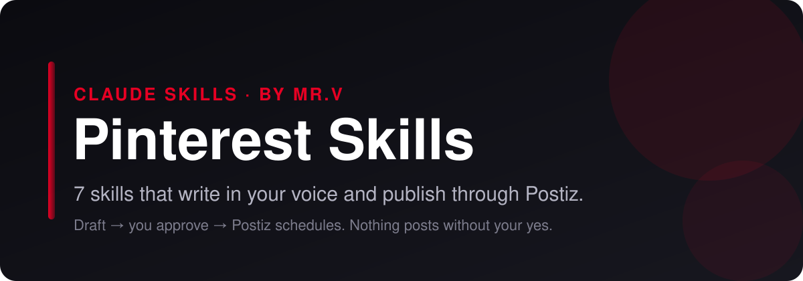

<p align="center">
  
</p>

# Pinterest Skills for Claude Code, Claude.ai and Codex

<p align="center">
  
  
  
  
  
</p>

**Claude skills for Pinterest.** 7 skills that plan, write, scrub and publish your Pinterest content. They draft in your voice, strip the AI tells, and hand finished posts to [Postiz](https://postiz.com) for scheduling, only after you approve. No coding required.

> **On another platform too?** Matching bundles: [LinkedIn](https://github.com/mrvsubstack/linkedin-skills) · [X (Twitter)](https://github.com/mrvsubstack/x-skills) · [Instagram](https://github.com/mrvsubstack/instagram-skills) · [Threads](https://github.com/mrvsubstack/threads-skills) · [YouTube](https://github.com/mrvsubstack/youtube-skills) · [Facebook](https://github.com/mrvsubstack/facebook-skills) · [TikTok](https://github.com/mrvsubstack/tiktok-skills) · [Reddit](https://github.com/mrvsubstack/reddit-skills). Same voice rules, same approve-before-publish flow.

> **Want the full library?** These are a free sample of the Mr V Skills library: 240+ skills for writing, newsletters, offers, ads, SEO and research. [Get it on Substack →](https://promptwithjason.substack.com)

## Install

### Claude.ai (web) or Claude Desktop

1. Click **Customize** in the sidebar and open **Plugins**
2. **Add** → **Add marketplace** → **Add from a repository**
3. Paste `mrvsubstack/pinterest-skills` and sync
4. Open **Discover**, find **pinterest-skills**, click **+** to install
5. Start a new chat and ask for a Pinterest post

> Plugins need a paid Claude plan with code execution turned on.

### Claude Code

```
/plugin marketplace add mrvsubstack/pinterest-skills
/plugin install pinterest-skills@pinterest-skills
```

Or clone it and open the folder. The `.claude/skills/` folder points at every skill, so they load with no install:

```bash
git clone https://github.com/mrvsubstack/pinterest-skills.git
cd pinterest-skills
```

### Any agent (Codex, Cursor and others)

```bash
npx skills add mrvsubstack/pinterest-skills
```

Or point your agent at `skills/*/SKILL.md`. Each one is plain markdown.

> **Found this useful? [Star the repo](https://github.com/mrvsubstack/pinterest-skills).** It's how the next person finds it.

## What you can do

Ask in plain English. The right skill picks itself.

**Write pins:**
> "Write 5 pin titles and descriptions for this blog post: [url]"

**Find keywords:**
> "Pinterest keyword research for 'small apartment storage'."

**Plan boards:**
> "Plan my board structure for a vegan recipe blog."

**Brief the design:**
> "Pin design brief for this title: [title]"

**Ship it:**
> "Schedule these 5 pins to my 'Recipes' board through Postiz, one a day."

Every skill shows you a draft first. Nothing goes out until you say yes.

## The 7 skills

| Skill | What it does |
|---|---|
| **Pin Writer** (`pin-writer`) | Writes Pinterest pin titles, descriptions, image overlay text and alt text that get found in search and earn the click to your site. Builds each pin around one keyword, front-loads it, writes descriptions as readable sentences with a reason to click, and gives 3 to 5 fresh variations of the same link so you can pin it again with new copy. |
| **Pinterest SEO** (`pinterest-seo`) | Runs keyword research for Pinterest using Pinterest's own search: autocomplete, the guided-search bubbles under a search, related terms on top pins and Pinterest Trends. Builds a tiered keyword map (head, middle and long-tail terms) grouped by board and by intent, with where each keyword goes (profile, boards, pin titles, descriptions, alt text). |
| **Board Planner** (`board-planner`) | Designs a Pinterest board structure that ranks in search and organises your niche: 8 to 15 keyword-named boards built from what people search, a description for each, section plans, board order on the profile, which existing boards to merge, rename or archive, and where every new pin belongs. |
| **Pin Design Brief** (`pin-design-brief`) | Writes a design brief for Pinterest pins built to be saved: vertical layout, one hero image, a text overlay that names the keyword or promise, colour and font choices, and a small-screen read test, delivered as 2 to 3 concepts plus a reusable template set for your brand. |
| **Idea Pin Scripter** (`idea-pin-scripter`) | Scripts multi-page and video pins (what Pinterest used to call Idea Pins) with a clear payoff: a cover page that names the result, page-by-page or shot-by-shot steps with on-screen text that works muted, a closing page that earns the save, plus title, description and voiceover lines. |
| **Pinterest Content Planner** (`pinterest-content-planner`) | Turns the content you already have (blog posts, products, videos, freebies) into a weekly Pinterest schedule: an inventory of what's pinnable, fresh-pin variations per link, board routing, a seasonal look-ahead and a realistic daily pin count. |
| **Postiz Publisher** (`pinterest-postiz-publisher`) | Checks a finished post against Pinterest's rules, shows you an approval card, and schedules it through Postiz after you say yes. Saves a copy-ready file when Postiz isn't set up. |

Some skills suggest companion skills from the other platform bundles or from the [full Mr V library](https://promptwithjason.substack.com) (for example `voice-profile-bank` or `final-edit-modes`). They're optional. Without them, each skill still does its whole job.

## Publish with Postiz

By default the skills hand you a copy-ready post. Connect [Postiz](https://postiz.com) and Claude can schedule it for you.

**Why Postiz:** it's open source, you can self-host it for free, and one account covers Pinterest plus 25+ other channels. The hosted plan works too.

**Setup (5 minutes):**

1. Create a Postiz account (or self-host it) and connect Pinterest under **Add Channel**.
2. Copy your API key from **Settings** → **Public API**.
3. Save it as an environment variable, not in the chat:
   ```bash
   export POSTIZ_API_KEY="your-key"
   # self-hosted only:
   export POSTIZ_API_URL="https://your-domain/api/public/v1"
   ```
4. Restart Claude and ask: **"List my Postiz channels."**

Full guide: [`skills/pinterest-postiz-publisher/references/postiz-setup.md`](skills/pinterest-postiz-publisher/references/postiz-setup.md).

**How a post ships:**

1. A writer skill drafts the post.
2. You edit until you like it.
3. `pinterest-postiz-publisher` checks it against Pinterest's limits and shows an approval card: account, local time and UTC, media, exact text.
4. You say yes. It schedules through Postiz and gives you the post id.

No key? It saves the post to `post-ready-to-paste.txt` instead. Nothing breaks.

**Not published through Postiz:** Nothing extra.

## Voice rules every skill follows

1. A number or a statement in line 1. Never open on a question.
2. Odd precision beats round numbers: "$4,730" reads like a receipt, "$5k" like a guess.
3. One real detail per post. If you didn't give one, the skill asks. It never invents one.
4. No stock AI words (leverage, robust, elevate, navigate, foster, delve).
5. No reveal bridges ("Here's the thing", "Plot twist:") and no staccato stacks ("Simple. Fast. Done.").
6. Em dashes capped at about one per 100 words.

## Troubleshooting

| Problem | Fix |
|---|---|
| Skills don't activate | Start a new chat after installing. In Claude Desktop, check the plugin is listed under **Yours**, not only **Discover**. |
| "Postiz isn't connected" | `POSTIZ_API_KEY` isn't visible to Claude. Set it in your shell profile, open a new terminal, restart Claude. |
| 401 from Postiz | The key is wrong or was regenerated. Copy it again from Settings → Public API. |
| 429 from Postiz | You hit Postiz's hourly posting limit. Wait and try again. |
| Pinterest channel not found | Connect it in the Postiz dashboard, or reconnect it if it shows as disabled. |
| Validation error on a post | A required platform setting is missing. The publisher reads the error and asks you for it. |

## Credits and license

Written from scratch by Mr.V.

MIT licensed. See [LICENSE](LICENSE). Not affiliated with Pinterest or Postiz.

Made by **Mr.V** · [Substack](https://promptwithjason.substack.com)
